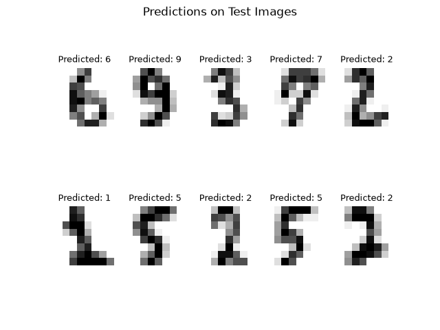
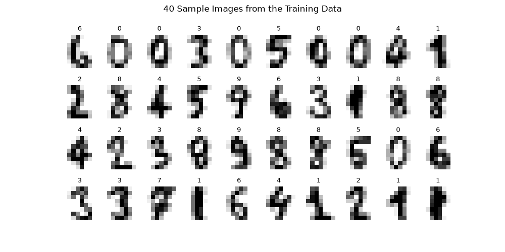
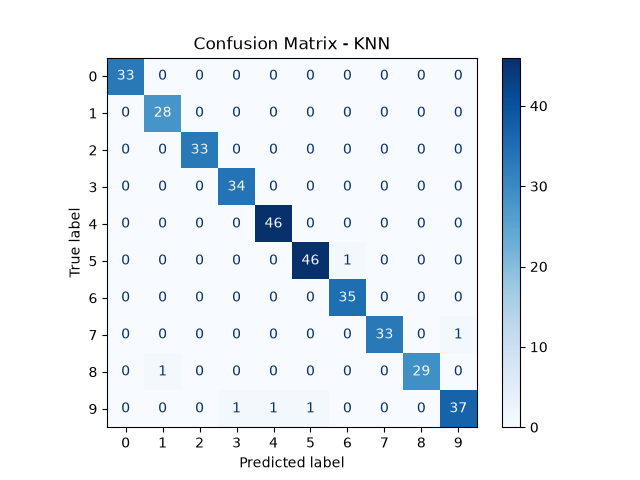

# Handwritten Digit Recognition using Machine Learning

Python Programming (MC-103) project, Department of Applied Mathematics, Delhi Technological University.

**Made by:** Soumil Malik (26/B06/038) and Sukhman Singh (26/B06/041)

The program looks at an 8×8 pixel image of a handwritten digit and predicts which digit (0–9) it is.
Three models are trained and compared on the scikit-learn digits dataset (1797 images).



## Results

| Model | Accuracy |
|---|---|
| Logistic Regression | 96.67 % |
| **K-Nearest Neighbours** | **98.33 %** |
| Decision Tree | 84.17 % |

KNN recognised 354 out of 360 test images correctly.

## How to run

```
pip install scikit-learn pandas matplotlib
python digit_recognition.py
```

The program prints its results and saves six graphs as PNG files.

## Files

- `digit_recognition.py` – the complete code
- `graph1_sample_digits.png` … `graph6_predictions.png` – graphs made by the program
- `ML Project Report - Soumil Malik, Sukhman Singh.pdf` – project report

## Graphs

| Training images | Confusion matrix |
|---|---|
|  |  |
